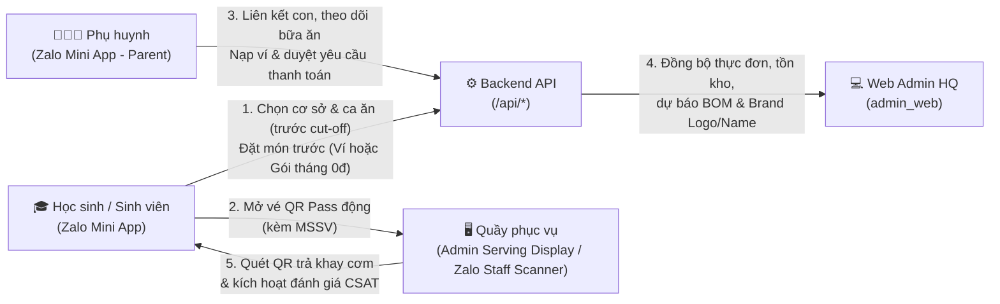

# INNOVIX Smart Canteen — Frontend (Web Admin & Zalo Mini App)

Repository này chứa **mã nguồn Frontend** của hệ thống **INNOVIX Smart Canteen** (quản lý chuỗi canteen trường học thông minh đa cơ sở), gồm 2 ứng dụng:

| Thư mục | Ứng dụng | Đối tượng sử dụng | Tech Stack | Cổng Dev |
| :--- | :--- | :--- | :--- | :--- |
| `admin_web/` | **Web Admin HQ & Serving Display** | Super Admin HQ, Admin cơ sở, Màn hình TV/POS quầy bếp | React 19, TypeScript, Vite, Tailwind CSS v4, Lucide, Recharts, jsQR, Axios | `http://localhost:5173` |
| `zalo_miniapp/` | **Zalo Mini App (Mobile Web)** | Học sinh/Sinh viên (`STUDENT`), Phụ huynh (`PARENT`), Nhân viên quầy (`STAFF`) | React 19, TypeScript, Vite, Tailwind CSS v4, Lucide, qrcode.react, jsQR, Axios | `http://localhost:5174` |

> **Lưu ý:** Backend API (`Node.js / Express / PostgreSQL`) nằm ở repo riêng. Bạn có thể trỏ Frontend tới server Backend local (`localhost:3000`) hoặc link HTTPS Backend (Cloudflare Tunnel / server deploy) qua file `.env`. Ngoài ra, `zalo_miniapp` có sẵn chế độ fallback demo offline khi chưa kết nối Backend.

---

## 1. Bức tranh tổng thể dự án & Luồng nghiệp vụ

Hệ thống số hóa toàn bộ quy trình đặt ăn và vận hành canteen trường học đa cơ sở:



### Quy ước nghiệp vụ quan trọng khi chỉnh Frontend
1. **Múi giờ `Asia/Ho_Chi_Minh` (UTC+7)**: Mọi bộ lọc ngày, ca ăn (`Sáng`, `Trưa`, `Tối`) và giờ chốt đơn (**Cut-off time**) đều tính theo giờ Việt Nam (`Asia/Ho_Chi_Minh`). Các ca ăn đã qua giờ cut-off cần hiển thị rõ trạng thái / ẩn đặt món mới đúng theo logic hiện tại.
2. **Không hiển thị Calories**: Dự án đã thống nhất ẩn thông tin calories khỏi giao diện món ăn.
3. **MSSV (`studentCode`) chỉ dành cho Học sinh**: Chỉ vai trò `STUDENT` mới xem/cập nhật MSSV ở trang cá nhân và hiển thị trên vé QR Pass.
4. **Đồng bộ Thương hiệu (Brand Sync)**: Tên thương hiệu và Logo canteen cấu hình trong `admin_web` (`BrandSettingsModal.tsx`, tự nén ảnh client-side) được đồng bộ qua API `/api/brand` sang cả `admin_web` (`BrandContext.tsx`) và `zalo_miniapp` (`AppContext.tsx`).
5. **Khóa cơ sở cho Học sinh / Phụ huynh**: Để tránh đặt nhầm món giữa các cơ sở trường học, cơ sở được chọn ban đầu (`SelectCanteenModal.tsx`) và cố định trên `HeaderBar.tsx` (chỉ đổi khi người dùng xác nhận chủ động).

---

## 2. Chi tiết `admin_web/` — Cổng Quản trị Web & Màn hình Quầy

### Cấu trúc thư mục
```text
admin_web/
├── index.html                          # Khai báo font & title mặc định
├── vite.config.ts                      # Dev server cổng 5173, proxy /api -> http://127.0.0.1:3000
├── .env.example                        # VITE_API_BASE_URL="http://localhost:3000/api"
├── .env.production.example             # Mẫu cấu hình domain API production
└── src/
    ├── index.css                       # Design tokens (--primary: #0062d2, slate palette, @theme inline, .tabular-nums)
    ├── App.tsx                         # Routing RESTful URLs, kiểm tra role/permission RBAC, chế độ TV fullscreen
    ├── services/api.ts                 # Axios instance (gắn Bearer token từ localStorage 'token', tự redirect /login khi 401)
    ├── context/
    │   ├── AuthContext.tsx             # Trạng thái đăng nhập, selectedCanteenId (HQ chọn toàn chuỗi hoặc 1 cơ sở), hasPermission
    │   ├── BrandContext.tsx            # Brand logo & brandName
    │   ├── ThemeContext.tsx
    │   └── ToastContext.tsx
    ├── components/
    │   ├── BrandSettingsModal.tsx      # Modal tùy chỉnh Brand Logo & tên thương hiệu
    │   ├── Layout/
    │   │   ├── AdminLayout.tsx         # Khung Sidebar cố định desktop + drawer mobile + Header
    │   │   ├── Sidebar.tsx             # Menu điều hướng phân nhóm (Tổng quan / Vận hành bếp / Quản trị hệ thống)
    │   │   └── Header.tsx              # Breadcrumb, bộ chọn cơ sở (Super Admin), nút refresh
    │   └── ui/                         # UI primitives: Badge, Button, Card, Input, Tabs, ImportStepper, ExcelValidationTable, ExcelCommitModal
    └── pages/
        ├── LoginPage.tsx               # Đăng nhập Admin/Super Admin + 2 nút quick-login demo + ping trạng thái server
        ├── DashboardPage.tsx           # /dashboard — KPI tổng quan chuỗi cơ sở, biểu đồ Recharts
        ├── MenuImportPage.tsx          # /menus — Quản lý thực đơn & import file Excel
        ├── InventoryPage.tsx           # /inventory — Kho nguyên liệu & cảnh báo tồn kho thấp
        ├── KitchenForecastPage.tsx     # /kitchen-forecast — Dự báo định lượng nguyên vật liệu bếp (BOM)
        ├── ServingDisplayPage.tsx      # /serving-counter & fullscreen /display/:canteenId — Màn hình quầy phát cơm, quét QR (jsQR)
        ├── CanteensPage.tsx            # /canteens — Quản lý mạng lưới cơ sở, giờ ca ăn, cut-off, tạo nhân viên
        ├── PackagesPage.tsx            # /meal-packages — Gói cơm tháng & hội viên
        ├── UsersPage.tsx               # /users — Quản lý tài khoản & phân quyền RBAC
        ├── FinancePage.tsx             # /finance — Sổ quỹ & đối soát tài chính
        ├── FeedbacksPage.tsx           # /feedbacks — Đánh giá chất lượng CSAT & xử lý khiếu nại
        └── AuditLogsPage.tsx           # /audit-logs — Nhật ký kiểm toán (chỉ SUPER_ADMIN)
```

### Lưu ý khi sửa UI/UX `admin_web`
- Chỉ cho phép `SUPER_ADMIN` và `ADMIN` đăng nhập; các tab có phân quyền riêng (`TAB_PERMISSION_MAP` trong `src/App.tsx`).
- Hỗ trợ đường dẫn màn hình TV công cộng không cần layout sidebar: `/display/:canteenId`, `/serving-counter/:canteenId`, `/pos/:canteenId`, `/tv/:canteenId`.
- Toàn bộ bảng số liệu, tiền tệ, thống kê dùng class `.tabular-nums` để căn thẳng cột số.

---

## 3. Chi tiết `zalo_miniapp/` — Ứng dụng Zalo Mini App

### Cấu trúc thư mục
```text
zalo_miniapp/
├── app-config.json                     # Cấu hình Zalo Mini App
├── index.html                          # Viewport mobile + font Plus Jakarta Sans
├── vite.config.ts                      # Dev server cổng 5174, proxy /api -> http://127.0.0.1:3000
├── .env.example                        # VITE_API_URL=/api
├── .env.production.example             # Mẫu cấu hình domain API production
└── src/
    ├── index.css                       # Mobile tokens (--color-primary: #0057b8, .safe-top, .safe-bottom, .modal-scrollable)
    ├── App.tsx                         # Khung mobile max-w-md, định tuyến theo 3 vai trò (STUDENT / PARENT / STAFF)
    ├── hooks/useModalScrollLock.ts     # Khóa cuộn nền khi mở modal trên mobile
    ├── services/
    │   ├── api.ts                      # Axios instance (gắn Bearer token từ localStorage 'canteen_zalo_token')
    │   └── zalo.ts                     # Wrapper window.ZMP (tự fallback mock user khi chạy trên browser thường)
    ├── context/
    │   └── AppContext.tsx              # Toàn bộ state giỏ hàng, đơn hàng, ví, con cái, hàng đợi quầy, chime audio & offline fallback
    ├── components/
    │   ├── HeaderBar.tsx               # Brand logo/tên, cơ sở đang khóa, nút chuyển nhanh vai trò, chuông thông báo, avatar
    │   ├── BottomNavigation.tsx        # Thanh tab dưới đáy riêng cho STUDENT / PARENT / STAFF
    │   ├── SelectCanteenModal.tsx      # Chọn cơ sở bắt buộc lần đầu / đổi cơ sở
    │   ├── DishDetailModal.tsx         # Chi tiết món ăn
    │   ├── CheckoutConfirmationModal.tsx # Xác nhận đặt món & chọn phương thức thanh toán
    │   ├── EditProfileModal.tsx        # Sửa thông tin cá nhân & MSSV (cho STUDENT)
    │   ├── FeedbackModal.tsx           # Gửi đánh giá CSAT
    │   ├── NotificationModal.tsx       # Danh sách thông báo
    │   ├── CanteenConfigModal.tsx      # Cấu hình nhanh canteen (cho STAFF)
    │   └── KitchenForecastModal.tsx    # Xem dự báo bếp nhanh (cho STAFF)
    └── pages/
        ├── LoginPage.tsx               # Đăng nhập + nút đăng nhập nhanh 1 chạm (Phụ huynh / Học sinh)
        ├── HomePage.tsx                # [STUDENT] /menu — Xem thực đơn theo ngày/ca, cut-off time, đặt món trước
        ├── WalletPage.tsx              # [STUDENT] /wallet — Ví điện tử, nạp VietQR, mua gói tháng
        ├── QRPassPage.tsx              # [STUDENT] /qr — Vé QR Pass nhận món (chỉ hiện khi có đơn hợp lệ trong ngày)
        ├── FeedbackPage.tsx            # [STUDENT & PARENT] /feedback — Gửi & xem đánh giá CSAT
        ├── ProfilePage.tsx             # [ALL] /profile — Thông tin cá nhân, cập nhật MSSV, đăng xuất
        ├── ParentPage.tsx              # [PARENT] /children, /parent-menu, /parent-wallet — Cổng phụ huynh
        ├── StaffPage.tsx               # [STAFF] /overview, /branch-menu, /scan, /staff-users, /feedbacks — Quét QR jsQR & quản lý quầy
        └── CartPage.tsx                # (Legacy) Hiện không còn mount trong App.tsx; luồng xác nhận đơn dùng CheckoutConfirmationModal.tsx từ HomePage.tsx
```

### Lưu ý khi sửa UI/UX `zalo_miniapp`
- Giao diện thiết kế theo khung mobile (`w-full max-w-md`), cần đảm bảo thao tác chạm mượt trên màn hình `360px - 430px`, không tràn ngang (`overflow-x`), modal có `.modal-scrollable` và tôn trọng `.safe-bottom` / `.safe-top`.
- Thanh `BottomNavigation.tsx` thay đổi theo 3 vai trò:
  - **`STUDENT`**: `Đặt món` (`/menu`), `Ví Canteen` (`/wallet`), nút tròn nổi **`QR Nhận`** (`/qr`), `Đánh giá` (`/feedback`), `Tài khoản` (`/profile`).
  - **`PARENT`**: `Theo dõi con` (`/children`), `Thực đơn` (`/parent-menu`), `Nạp ví` (`/parent-wallet`), `Góp ý` (`/feedback`), `Cá nhân` (`/profile`).
  - **`STAFF`**: `Tổng quan` (`/overview`), `Thực đơn` (`/branch-menu`), `Quét QR` (`/scan`), `Người dùng` (`/staff-users`), `CSAT` (`/feedbacks`).

---

## 4. Hướng dẫn cài đặt & chạy Local

**Yêu cầu:** Node.js >= 18 (khuyến nghị Node 20 LTS) và npm.

### Chạy Web Admin (`admin_web`)
```bash
cd admin_web
npm install
cp .env.example .env    # Trên Windows PowerShell: copy .env.example .env
npm run dev             # Mở http://localhost:5173
```

Các lệnh kiểm tra trước khi commit/PR:
```bash
npm run lint            # Chạy oxlint
npm run build           # Kiểm tra TypeScript (tsc -b) + Vite build
```

### Chạy Zalo Mini App (`zalo_miniapp`)
```bash
cd zalo_miniapp
npm install
cp .env.example .env    # Trên Windows PowerShell: copy .env.example .env
npm run dev             # Mở http://localhost:5174
```

Kiểm tra build:
```bash
npm run build           # Kiểm tra TypeScript (tsc -b) + Vite build
```

### Kết nối Backend khi phát triển Frontend
- **Cách 1 (Chạy kèm Backend local ở cổng `3000`)**: Đặt `VITE_API_BASE_URL=/api` (trong `admin_web/.env`) và `VITE_API_URL=/api` (trong `zalo_miniapp/.env`). Vite sẽ tự proxy `/api` sang `http://127.0.0.1:3000`.
- **Cách 2 (Dùng Backend qua link HTTPS Tunnel / Server từ xa)**: Điền trực tiếp URL API vào `.env`:
  - `admin_web/.env`: `VITE_API_BASE_URL=https://<backend-domain>/api`
  - `zalo_miniapp/.env`: `VITE_API_URL=https://<backend-domain>/api`

---

## 5. Tài khoản Demo mặc định (khi kết nối Backend demo)

Mật khẩu chung: `123456`

| Vai trò | Email | Ứng dụng sử dụng |
| :--- | :--- | :--- |
| **Super Admin HQ** | `admin@smartcanteen.vn` | `admin_web` |
| **Admin Cơ sở 1** | `admin.cs1@smartcanteen.vn` | `admin_web` & `zalo_miniapp` (STAFF) |
| **Học sinh (Student)** | `student@smartcanteen.vn` | `zalo_miniapp` (STUDENT) |
| **Phụ huynh (Parent)** | `parent@smartcanteen.vn` | `zalo_miniapp` (PARENT) |
